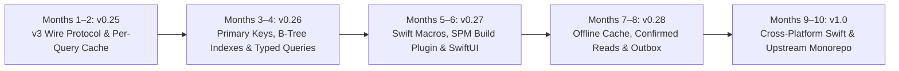

# SpacetimeDB Swift SDK Roadmap (`v0.24` → `v1.0`)

This document tracks the 8–10 month engineering roadmap for `spacetimedb-swift`, progressing from `v0.24.0` to a production-hardened, cross-platform `v1.0.0` release with full SpacetimeDB protocol and ecosystem parity.

---

## Completed Baseline (`v0.24.0`)

- [x] `v2.bsatn.spacetimedb` WebSocket transport over `Network.framework` (`NWWebSocketTransport`) with frame reassembly and Gzip/Brotli compression.
- [x] Swift 6 strict concurrency (`Sendable`, `Mutex<State>`, `@MainActor` coalesced `@Observable` table snapshots).
- [x] Explicit subscriptions by default on connect, with managed reconnect replay (`subscribe(queries:)` and `subscribeAll(tables:)`).
- [x] Refcounted `TableCache` deduplication and `0 -> 1` / `1 -> 0` delta callbacks (`onInsert`, `onDelete`, `onUpdate`).
- [x] TypeScript SDK-style reconnect reconciliation (`TableCache.reconcile(rowBytesList:)` and `ClientCache.reconcile(queryRowsList:replacingTables:)`).

---

## Phase 1: `v3` Wire Protocol & Per-Query Storage (`v0.25` — Months 1–2)

**Goal:** Achieve wire-protocol parity with the official Rust and TypeScript 2.13+ SDKs and isolate cache state per connection and per query set.

- [x] **WebSocket `v3` Protocol & Frame Batching**
  - [x] Negotiate `v3` WebSocket subprotocol alongside `v2.bsatn.spacetimedb`.
  - [x] Implement bounded multi-message outbound frame batching (`MAX_V3_OUTBOUND_FRAME_BYTES`) with same-turn coalescing and deferred yield flushes.
  - [x] Implement streaming `v3` multi-message inbound frame decoding.
- [x] **Per-Query-Set Cache Tracking**
  - [x] Track row membership by `QuerySetId` inside `ClientCache` and `TableCache`.
  - [x] Deterministically evict rows belonging to a failed or unsubscribed `QuerySetId` without requiring server-sent dropped rows or connection resets.
- [x] **Instance-Scoped `ClientCache`**
  - [x] Introduce connection-scoped `ClientCache` / `DbContext` instances on `SpacetimeClient` while preserving `SpacetimeClient.clientCache` as a backwards-compatible default.
  - [x] Support concurrent independent `SpacetimeClient` connections to multiple modules or rooms in the same process.

---

## Phase 2: Primary Keys, Client-Side Indexes & Typed Query Builder (`v0.26` — Months 3–4)

**Goal:** Deliver sub-millisecond indexed lookups, primary-key identity semantics, and compile-time checked subscription queries.

- [x] **Primary-Key Identity & Semantic `onUpdate` Pairing**
  - [x] Add `SpacetimePrimaryKeyRow` protocol and generated primary-key extractors.
  - [x] Key `TableCache` entries by primary key when available (matching Rust's `with_updates_by_pk` and TypeScript's `hasPrimaryKey`).
  - [x] Pair delete+insert operations sharing a primary key into `onUpdate(oldRow, newRow)` callbacks across both incremental transactions and reconnect reconciliations.
- [x] **Client-Side Unique & B-Tree Ranged Indexes**
  - [x] Implement `UniqueIndex<Row, Key>` supporting $O(1)$ `.find(_:)` lookups.
  - [x] Implement `BTreeIndex<Row, Key>` supporting $O(\log N)$ `.filter(range:)` prefix and range scans.
  - [x] Automatically maintain index structures during `TableCache` insert, delete, update, and reconnect reconciliation passes.
- [x] **Type-Safe Query Builder DSL**
  - [x] Provide a Swift `KeyPath`-based query builder (e.g., `Person.where { $0.roomId == 7 && $0.isReady == true }`).
  - [x] Compile typed expressions into parameterized SQL subscription strings.

---

## Phase 3: Zero-Step Codegen (SPM Plugin + Swift Macros) & SwiftUI Ergonomics (`v0.27` — Months 5–6)

**Goal:** Eliminate manual codegen steps in Xcode/SPM projects and provide first-class SwiftUI and `AsyncSequence` primitives.

- [x] **Swift Package Manager Build Tool Plugin (`SpacetimeDBCodegenPlugin`)**
  - [x] Generate typed Swift tables, reducers, and procedures automatically during `swift build` / Xcode builds from module schema definitions.
  - [x] Add schema drift detection and actionable compiler diagnostics.
- [x] **Swift 6 Table Descriptors & Property Wrappers (`SpacetimeTableDescriptor`, `@SpacetimePrimaryKey`, `@SpacetimeUniqueIndexed`, `@SpacetimeBTreeIndexed`)**
  - [x] Synthesize zero-copy `BSATNSpecialDecodable` and `BSATNSpecialEncodable` conformances and table/query metadata in `spacetime generate --lang swift`.
  - [x] Provide declarative primary-key, index, and table descriptor annotations (`SpacetimeTableDescriptor`, `@SpacetimePrimaryKey`, `@SpacetimeUniqueIndexed`, `@SpacetimeBTreeIndexed`).
- [x] **SwiftUI Property Wrappers & Structured Concurrency Streams**
  - [x] Add `@SpacetimeQuery` property wrapper for SwiftUI views with automatic view-lifecycle `subscribe()` / `unsubscribe()` management and fine-grained observation.
  - [x] Expose `AsyncSequence` streams for table events (`table.inserts`, `table.deletes`, `table.updates`) and connection lifecycle (`client.connectionStates`).

---

## Phase 4: Confirmed Reads, Optimistic Mutations & Persistent Offline Cache (`v0.28` — Months 7–8)

**Goal:** Built-in mobile resilience for flaky networks, instant cold-start rendering, and latency-masked reducer calls.

- [x] **`lightMode` & `confirmedReads` Connection Options**
  - [x] Support `lightMode` query parameter negotiation to minimize bandwidth on cellular/watchOS connections.
  - [x] Support `confirmedReads` negotiation for durability-sensitive client workflows.
- [x] **Optimistic Reducer Predictions & Rollback**
  - [x] Allow registering optimistic local cache mutations alongside `send(reducer:args:)`.
  - [x] Automatically commit or roll back optimistic mutations when `ReducerResult` arrives (`.ok` vs `.err` / `.internalError`) or on disconnect.
- [x] **Disk-Backed Cache Snapshots**
  - [x] Add opt-in BSATN snapshot persistence to disk per module/query-set.
  - [x] Hydrate `ClientCache` synchronously on cold launch and seamlessly diff against live server state via `ClientCache.reconcile(queryRowsList:replacingTables:)` once connected.

---

## Phase 5: Cross-Platform Swift, Chaos Harness & Upstream `1.0` (`v1.0.0` — Months 9–10)

**Goal:** Expand beyond Apple platforms to Linux/Windows/Android, prove reliability under chaos testing, and land upstream in `clockworklabs/SpacetimeDB`.

- [x] **Cross-Platform WebSocket Transport**
  - [x] Provide a `URLSessionWebSocketTask` / `SwiftNIO` transport backend behind `WebSocketTransport` alongside `NWWebSocketTransport`.
  - [x] Add CI targets for `tvOS`, `iOS`, `visionOS`, `watchOS`, and `macOS` in `.github/workflows/ci.yml`.
- [x] **Deterministic Chaos & Soak Testing Suite**
  - [x] Build an automated multi-client chaos harness (`ChaosSoakTests`) simulating mid-stream socket drops, interleaved `TransactionUpdate`s during reconnect replay, optimistic rollbacks, and 60 Hz reducer streams.
  - [x] Enforce automated benchmark manifest and Thread Sanitizer (`--sanitize=thread`) checks in CI.
- [x] **Upstream Monorepo Integration & `1.0` API Lock**
  - [x] Sync `spacetime generate --lang swift` (`crates/codegen/src/swift.rs`) and `sdks/swift` into the SpacetimeDB monorepo.
  - [x] Update DocC catalog (`SpacetimeDB.docc`) with all `v0.25`–`v1.0` symbols and tutorials.
